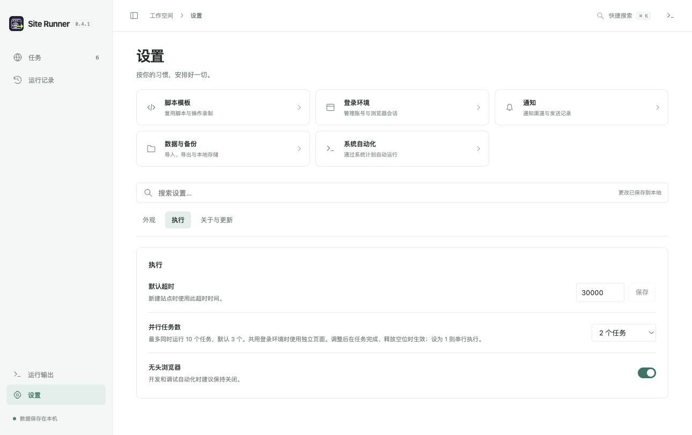
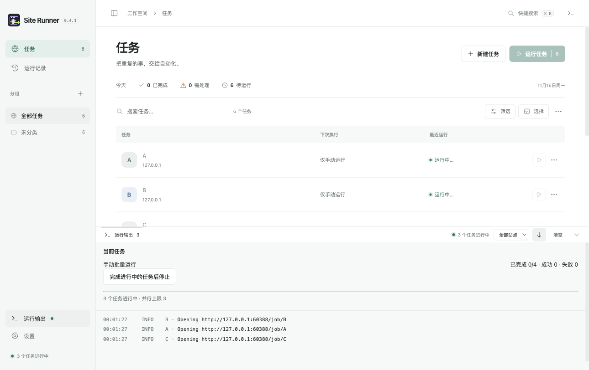

# 并行执行 · v0.4.1

在 **设置 → 执行 → 并行任务数** 选择 1–10 个，默认 3 个。设为 1 时恢复串行。设置自动保存在本地，重启及配置导入导出后仍保留。旧配置缺少此字段时使用默认值 3，无需迁移数据库或重新登录。

这个数字是整个应用的上限，手动单次任务、手动批次、分组计划和独立定时任务共用额度。调整后，新领取的任务遵循当前上限；已开始的任务不会被中断。已有批次自身的工作槽位数在开始时确定，提高上限可以在下一批任务中充分使用。

## 共用登录环境也能并行

同一登录环境复用一个持久化 Chromium 浏览器，每个任务获得独立页面，复用已有 Cookie、LocalStorage 和登录状态。不同登录环境仍保持账号隔离。浏览器目录只由所属浏览器写入，避免多个 Chromium 进程同时打开同一个目录。

每个任务仍运行在独立 Worker 中。卡死脚本由主进程超时终止，所属页面和弹窗由主进程清理，其余任务可以继续。最后一个任务完成后关闭持久化浏览器并保存状态。串行模式仍保留原来的单任务执行路径。

底层通过 Playwright 的本机管道连接共享浏览器，不对外开放调试端口；API 行为参见 [Browser.bind](https://playwright.dev/docs/api/class-browser#browser-bind) 和 [Browser.close](https://playwright.dev/docs/api/class-browser#browser-close)。脚本继续使用传入的 `page`；浏览器和 Context 生命周期由应用管理，脚本不应主动关闭共用的 Context 或 Browser。

## 进度、失败与停止

- 一个任务完成后立即补位，不必等待整组任务完成。某个任务失败不会阻断其他任务。
- 进度按实际完成的任务 ID 更新；先完成列表后面的任务，不会错误解锁前面仍在执行的任务。最终结果按原列表顺序汇总。
- 点击「完成进行中的任务后停止」后，不再领取后续任务。尚在等待全局空位的任务取消且不产生运行记录，已开始的任务完成后再汇总。
- 一个批次只发送一次汇总通知。退出时等待已开始任务和通知收尾，保留原有退出保护。
- 手动登录、录制、删除登录环境及编辑待执行任务的占用保护继续生效。

## 验证与交付

验证使用临时数据库与受控的本地 HTTP 网页，不执行正式网站的签到或账户操作。除了完整测试，还通过真实 Electron、真实 Chromium 和独立 Worker 验证：

- 六个任务共用一个登录环境，实际同时进入三个受控网页；设置为 2 后最多两个。
- Cookie 和 LocalStorage 复用、独立页面内容检查、乱序完成的占用状态、失败隔离。
- 两个任务已开始时停止六任务批次，最终只产生两个结果；其余任务不启动。
- 默认值、1–10 的校验、旧配置兼容、设置持久化、多个批次与单次运行共用全局上限。

本轮 31 个测试文件、105 项测试全部通过；类型检查、Lint、构建通过，最终 0.4.1 应用包完成真实并发和最小窗口双语回归。实际卡死一个 Worker 后，同环境的另一个任务仍成功完成，后续任务也能补位执行。

最新结果见 [parallel-verification.json](parallel-verification.json)。执行 `node tests/e2e/concurrency.mjs` 可以复跑真实并发检查，需先构建；设置 `SITE_RUNNER_TEST_EXECUTABLE` 可改为验证打包应用。

macOS Apple Silicon 应用：`release/mac-arm64/Site Runner.app`。完全退出旧版后再打开新版，沿用原数据目录。Windows 安装流程尚未在 Windows 实机验证。正式发布与升级记录见 [发布说明](RELEASE-0.4.1.md)。
