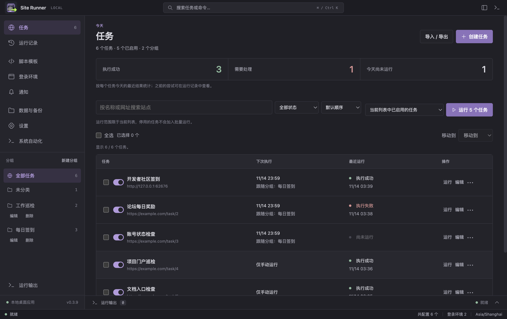
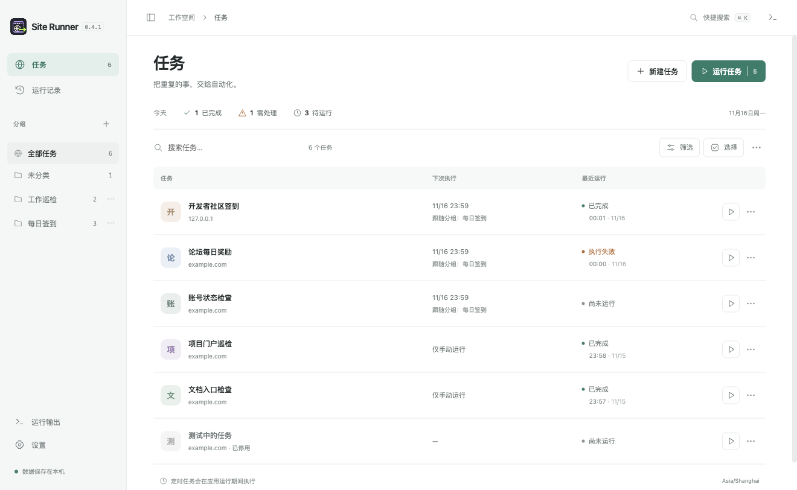
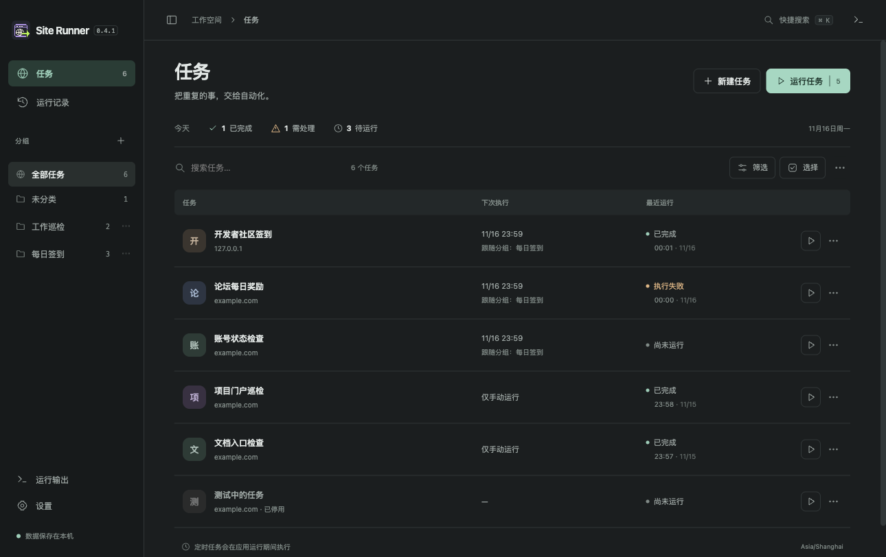
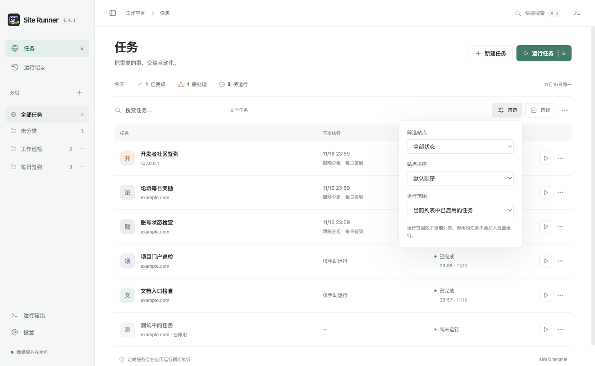
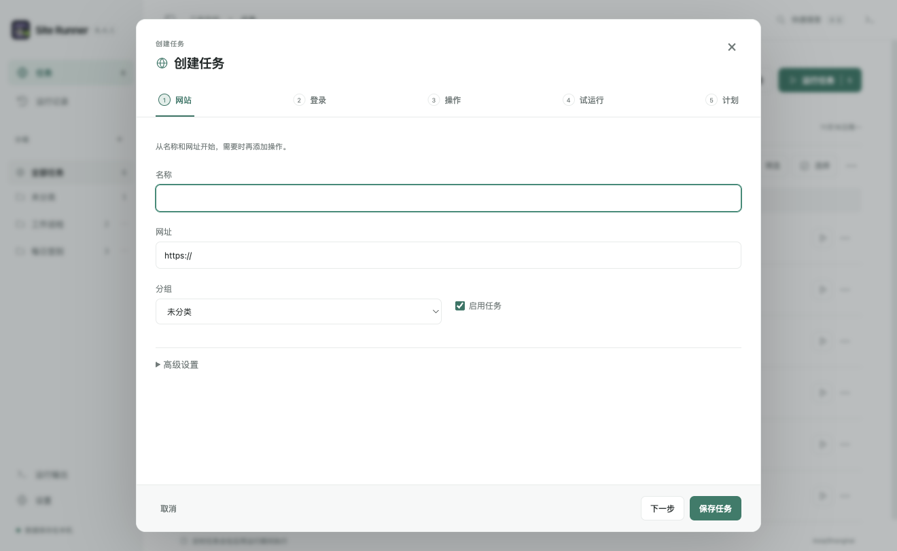
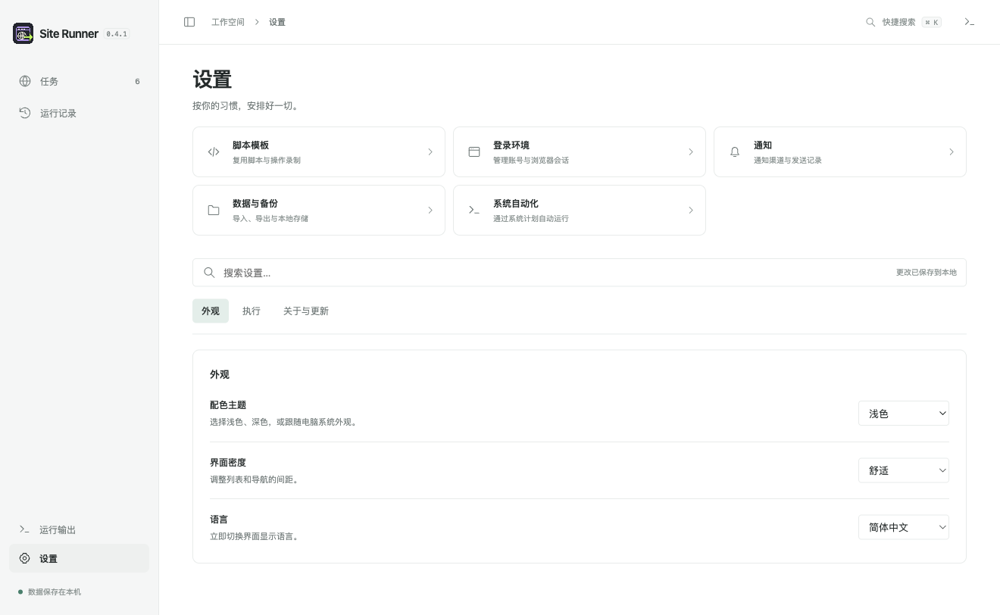

# Site Runner 0.4.1 前端重构

2026-11-16 · 正式版本 **0.4.1**。

此前内部试作包曾使用 2.0 名称，均未发布；现统一为 0.4.1，衔接已发布的 0.3.9。新版包含简洁界面、可设置的并行执行及跟随系统主题。当前测试及升级记录见 [0.4.1 发布说明](RELEASE-0.4.1.md)。

## 旧版界面的问题

先以原版源码构建并启动独立 Electron 实例，截取旧版界面，再完成重构。所有截图均来自临时数据库的演示任务，未读取或修改正式任务与登录信息。



1. **入口没有主次。** 任务、记录、模板、登录环境、通知、备份、设置、系统自动化八个入口同级展开，日常执行和低频配置同时争夺注意力。
2. **任务出现得太晚。** 大标题、三张统计卡片、统计口径说明、搜索和筛选、运行范围、选择工具及说明依次堆叠，压缩了列表首屏空间。
3. **每行有太多控件。** 复选框、启停开关、完整 URL、计划、结果、时间、运行、编辑和更多操作同时展示，难以快速扫描任务名称和异常。
4. **状态信息重复。** 侧栏运行输出、输出栏、侧栏本地状态和底部状态栏重复表达相近信息，增加了视觉边界。
5. **低频动作长期占位。** 分组编辑/删除、批量移动、导入导出始终展示，即使当前并不需要它们。

## 新版界面

### 任务页





主导航为任务、运行记录、设置。任务页保留创建和运行两个主要动作，运行按钮显示实际执行数量。今天的结果压缩为可点击筛选的一行摘要。

每个任务默认展示名称、域名、计划、最近结果和运行入口。点击任务名称编辑；行尾菜单提供编辑、打开网站/登录、启停和删除。完整网址保留在提示和编辑器中。停用任务有明确标记，仍允许显式单次运行，批量运行会排除停用任务。

**筛选**打开状态、排序和运行范围；**选择**开启复选框及批量移动。勾选当前可见任务后，运行按钮优先执行已勾选且启用的任务。切换搜索、分组和状态会清空勾选，退出选择也会清空。视图状态在切换页面时保留。



### 任务编辑



编辑器改为居中浮层，横向展示网站、登录、操作、试运行和计划五个步骤。首步只展开基础字段，高级选项按需打开；保留 TypeScript、Monaco、可视化流程、操作录制、试运行、计划继承、未保存修改确认及焦点管理。步骤支持方向键、Home 和 End。

### 设置与运行输出



模板、登录环境、通知、数据与备份、系统自动化从设置进入；外观、执行默认值、关于与更新分成独立分类。所有页面仍可通过 ⌘K / Ctrl+K 的命令搜索直达。

输出面板默认关闭。运行时显示简短进度入口，点击或使用 ⌘J / Ctrl+J 展开日志和停止后续任务。移除重复的常驻状态栏。侧栏可用 ⌘B / Ctrl+B 折叠。

## 保留的技术与数据

- Electron、React、TypeScript、SQLite、Playwright / Chromium、Monaco，未引入另一套 UI 框架或外部素材服务。
- 沿用数据库结构、userData 路径、Preload API、任务调度、脚本执行、录制、通知、配置导入导出及更新器。
- 已有任务、脚本、分组计划、浏览器登录状态和通知配置直接复用。本次没有修改正式数据库或清空配置。
- 保留浅色、深色、系统主题、舒适/紧凑密度和中英文偏好。
- 版本号改为 0.4.1；发布更新包沿用原来的安装路径与数据目录，旧版发布压缩包保留。

## 运行与验证

开发运行：`pnpm dev`。构建后运行：`pnpm build`、`pnpm start`。

Apple Silicon 本地应用：`release/mac-arm64/Site Runner.app`。先完全退出旧版，再双击此应用，使用原有数据目录。正式账号的网站操作没有参与测试，截图中的成功/失败仅为隔离演示数据。

验证包括类型检查、Lint、生产构建、完整测试，以及真实 Electron 的导航、录制、并行任务、系统主题和重启持久化。最新结果见下方验证记录。

验证记录见 [verification.json](verification.json)。界面回归使用临时数据库及本地 HTTP 网页；最小窗口验证为 1040 × 680，包含中英文、深浅色、导航、编辑、录制、日志和运行范围检查。当前环境为 macOS Apple Silicon，Windows 安装包与实机尚未验证。

正式发布版本统一为 0.4.1；发布与旧版升级验证见 [0.4.1 发布说明](RELEASE-0.4.1.md)。

复跑主要界面检查（先构建）：

```bash
pnpm typecheck
pnpm lint
pnpm test
pnpm build
node tests/e2e/workbench-shell.mjs
node tests/e2e/site-management.mjs
node tests/e2e/workspace.mjs
node tests/e2e/first-run.mjs
```

核验应用包时，将 `SITE_RUNNER_TEST_EXECUTABLE` 设置为 `release/mac-arm64/Site Runner.app/Contents/MacOS/Site Runner` 的绝对路径。
